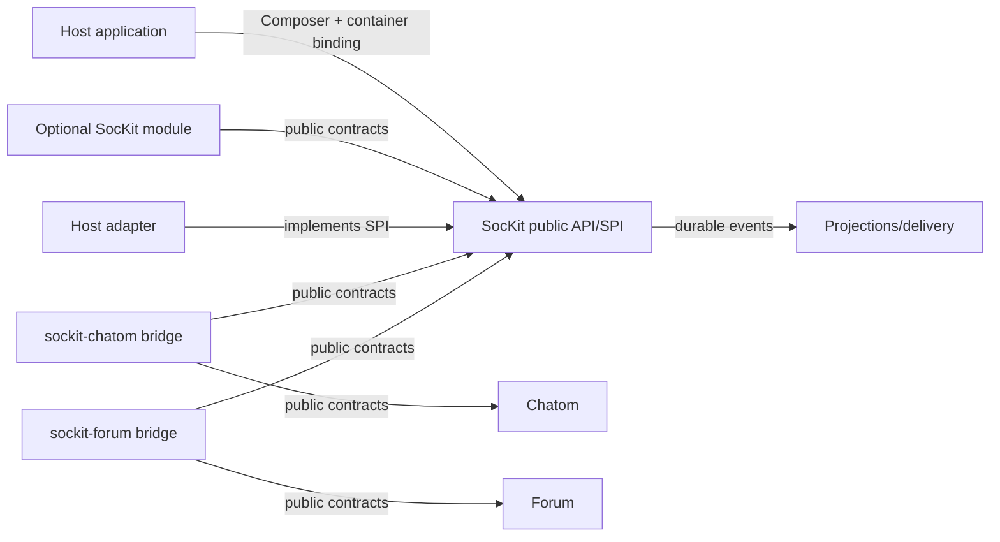
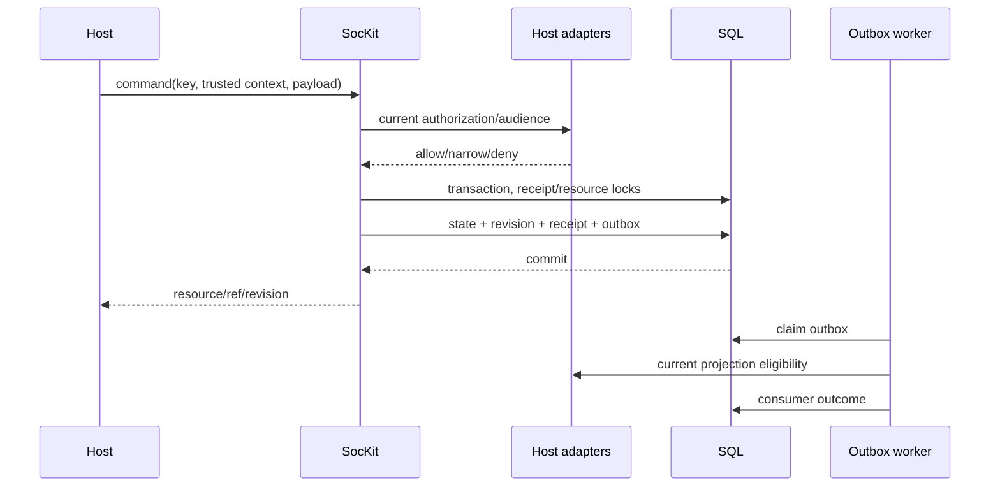
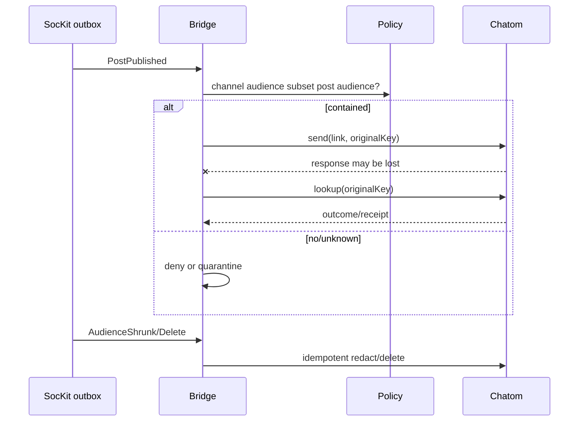
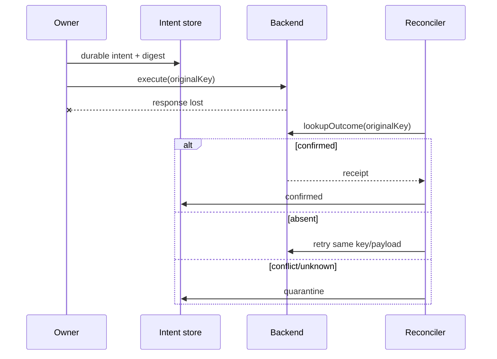

# SocKit: архитектурное исследование встраиваемого social-core

**Дата проверки внешних источников:** 17 октября 2026 года.  
**Статус:** восстановленная первая полная версия отчёта.  
**Исходные условия:** SocKit, Edufy, Chatom, Forum и AzGuard описываются по заданию заказчика; внешние решения используются только как референсы.

## 1. Рекомендуемая архитектура и reuse verdict

### Прямой вывод

Рекомендуется разрабатывать собственный встраиваемый `social-core` на PHP/Laravel. Минимальная полезная вертикаль должна включать surfaces, нативные посты, нативные комментарии, социальные реакции, хронологическую ленту, текущую проверку аудитории, revision/CAS, идемпотентные receipts, tombstones и transactional outbox.

Chatom, Forum, поиск, ranking, доставки, UI, admin и клиентские SDK не должны быть обязательными зависимостями ядра. Они подключаются через отдельные адаптеры, мосты и проекции.

Готовые социальные платформы полезны как доноры механизмов, но не подходят как embedded dependency: Flarum, Discourse, NodeBB, Mastodon, HumHub и Fresns владеют собственным приложением, runtime, identity/ACL или инфраструктурой. `cybercog/laravel-love` ближе к библиотеке, но покрывает только реакции и не решает surfaces, posts/comments/feed, trusted actor, current audience, privacy revocation, receipts и lifecycle.

### Пять главных решений

1. **Полезное ядро, а не пустой набор интерфейсов.** Ядро самостоятельно обслуживает publish → feed → comment → reaction.
2. **Current authorization на каждом защищённом выходе.** Feed/search/cache возвращают кандидатов, но не окончательное право доступа.
3. **Один authoritative writer на каждую state identity.** Проекция не становится второй редактируемой копией.
4. **Embedded-first SQL profile.** Domain state, revision, receipt и outbox intent сохраняются одной транзакцией.
5. **Малая типизированная API/SPI-поверхность.** DTO, enums, events и exceptions публичны; ORM, SQL и pipeline остаются `Internal`.

### Сильнейшие возражения

- Current authorization может быть дорогим. Ответ: batch verdict, coarse SQL filtering, generation caches и projection pruning, но не доверие stale projection.
- Receipts/outbox/tombstones выглядят тяжёлыми. Однако без receipt потерянный ответ создаёт duplicate; без tombstone старое событие воскрешает body; без outbox подтверждённая мутация теряет доставку.
- Собственное ядро повторяет социальные платформы. Повторяется функция, но не deployment boundary: SocKit должен встраиваться в чужое Laravel-приложение и принимать host identity/context.

## 2. Матрица референсов

| Кандидат | Тип | Что полезно | Почему не полная dependency |
|---|---|---|---|
| Laravel Love | Composer library, MIT | Reactable-модель, reaction vocabulary | Нет posts/comments/feed/surfaces/current audience/receipts |
| Flarum | PHP forum application/framework, MIT | Extender API, events, policies, query visibility | Владеет форумным runtime и моделями |
| Fresns | Laravel social application, Apache-2.0 | API-first, plugins, content forms | Полноценная платформа с account/theme/plugin subsystems |
| HumHub | PHP/Yii application, AGPL | Spaces/content/modules/permissions | Собственная identity и platform runtime |
| Discourse | Rails application, GPL | Guardian, thread lifecycle, plugin API | Ruby/PostgreSQL/Redis и отдельное приложение |
| NodeBB | Node.js application, GPL | Realtime forum, plugins, DB abstractions | Node runtime и отдельный datastore |
| Mastodon | Rails application, AGPL | Visibility, idempotency, feed fan-out | Federation/Redis/Sidekiq и линейная visibility-модель |
| OpenFGA/Zanzibar | Authorization model/service | Parent-child/object relations | Внешний PDP не нужен как обязательная v1 dependency |
| PostgreSQL | SQL database | Locks, unique indexes, CTE, partial indexes | Выбранная основная production СУБД, не policy engine |

Вывод: внешние проекты использовать как **доноров механизмов**, а не как основу runtime. Любое копирование GPL/AGPL-кода требует отдельной лицензионной оценки.

## 3. Kernel, modules, packages и host

| Элемент | Размещение | Инвариант | Dependency/storage tax | Deletion test |
|---|---|---|---|---|
| Surface registry/lifecycle | Kernel | kind/instance/incarnation однозначны | Таблицы surfaces/bindings | Без него нет безопасной привязки к host entity |
| Trusted actor/context | Kernel + host SPI | Клиентский ID не удостоверяет actor | Обязательный adapter | Без него direct PHP/worker обходят auth |
| Authorization/audience ports | Kernel + host SPI | Unknown fail closed | Adapter calls/cache | Без него privacy невозможна |
| Posts/body/revisions | Kernel | Один writer, revision monotonic | Posts/revisions | Нет публикации |
| Native comments | Kernel | Дерево, revision, tombstone parent | Comments/revisions | Edufy не работает без Chatom |
| Social reactions | Kernel | Unique membership, current visibility | Reactions/counters | Минимальная social vertical неполна |
| Chronological feed | Kernel | Stable cursor, current audience | Индексы | Posts нельзя потреблять как ленту |
| Receipts/outbox/tombstones | Kernel | Retry/replay/delete безопасны | Durable tables/worker | Ломаются failure scenarios |
| Groups | Internal optional module | Не смешиваются с host membership | Membership schema | Class-bound surfaces продолжают работать |
| Ranking/search | Optional projections | Не обходят privacy | Worker/index/service | Chronology остаётся |
| Media | SPI + associations | Bytes принадлежат media owner | Association table | Text-only работает |
| Safety | SPI + content states | Provider verdict отдельно от sanction | Provider/module | Без provider возможен профиль без moderation |
| Chat announcement | `sockit-chatom` bridge | Projection, не comment backend | Mapping/inbox/outbox | Social core работает |
| Chatom/Forum comments | Optional bridge | Immutable backend binding | Migration/reconcile | Native comments работают |
| HTTP/UI/admin/SDK | Delivery tracks | Не второй domain writer | Отдельные packages | PHP API остаётся |
| Identity/membership/consent | Host | Host — source of truth | Host-owned | SocKit не должен заменять |

## 4. Dependency graph и ownership



| State | Writer | Public port | Source of truth |
|---|---|---|---|
| Surface binding/incarnation | SocKit | Surface API | SocKit SQL |
| Native post/comment body | SocKit | Content API | SocKit SQL |
| Social reactions | SocKit | Reaction API | SocKit SQL |
| Host identity/authentication | Host | ActorContext adapter | Host identity system |
| School/class/parent membership | Host | Audience/authorization SPI | Host system |
| Chat message/reaction | Chatom | Chatom public API | Chatom storage |
| Forum topic/vote/accepted answer | Forum | Forum public API | Forum storage |
| Chat-backed comment body | Chatom | Bridge | Chatom; SocKit mapping only |
| Media bytes | Media owner | Media SPI | External storage |
| Safety assessment | Safety provider | Safety SPI | Provider result |
| Notification delivery | Host delivery system | Event consumer | Delivery system |
| Search/ranking | Projection owner | Query provider | Rebuildable projection |

## 5. Surfaces, actor/context и privacy

### Surface identity

Следует разделить:

- **Surface kind** — зарегистрированный тип поведения, например `edufy.class.feed`.
- **Surface instance** — конкретная серверная область, привязанная к `HostEntityRef`.
- **Incarnation** — поколение lifecycle; восстановленный host ID не наследует старый content автоматически.
- **Backend binding** — `native`, `chatom` или `forum`; фиксируется для incarnation.

Внутри SocKit используются обычные FK. Opaque polymorphic reference допустим только на host boundary: `entity_type + entity_value`. Generic polymorphic tables для всех внутренних связей отвергаются из-за отсутствия referential integrity.

### Trusted actor/context

- HTTP middleware создаёт context из authenticated principal и server-side claims.
- Direct PHP caller получает context через trusted factory.
- Queue job передаёт минимальную signed/versioned context reference; worker заново разрешает current admission.
- Service actor имеет отдельный kind и provenance.
- `author_id`, `school_id` и `surface_id` из payload не предоставляют права.

### Audience algebra

Audience — versioned expression/set predicate, а не линейный rank. Базовые формы:

- `Group(id)`;
- `HostScope(type,id)`;
- `InstallationMembers`;
- `Public`;
- `Direct(actorRefs)`;
- `allOf`, `anyOf`, exclusions.

`Class(A)` и `Class(B)` имеют одинаковый уровень строгости, но разные множества readers. Platform minimum ограничивает surface policy; surface может только сузить; content audience задаёт intended audience; current admission пересекается с ней; safety/hold/hide/tombstone запрещают выдачу независимо от membership; commercial entitlement никогда не расширяет privacy.

### Privacy shrink

- Projection возвращает candidate IDs.
- Перед body выполняется current batch authorization.
- Cache key включает actor/context generation и resource privacy revision.
- Search index не является единственным gate.
- Notification worker повторно проверяет доступ.
- Media URL выдаётся короткоживущим broker после current check.
- Уже скачанные bytes отозвать невозможно.

Live membership, archive access и direct grants — разные политики. Их semantics после отзыва должен определить product owner.

### Концептуальная модель

- `surface_kinds`, `surfaces`, `surface_bindings`;
- `posts`, `post_revisions`;
- `comments`, `comment_revisions`;
- `reactions`, `reaction_counts`;
- `audience_specs`, `media_associations`;
- `command_receipts`, `outbox_events`, `consumer_inbox`;
- `resource_tombstones`;
- optional groups/projection cursors/bridge mappings.

Owned IDs — UUIDv7. External IDs сохраняются lossless с namespace.

### Comment tree и feed

V1: adjacency list с `parent_id`, `root_id`, `depth` и ограниченной глубиной. Удалённый parent превращается в non-content tombstone, дети сохраняются.

Feed: fan-out-on-read по `(surface_id, state, published_at, id)` с keyset cursor `(published_at,id)`. Offset pagination не используется. Fan-out-on-write, ranking и search являются optional projections.

### Примеры

| Сценарий | Host передаёт | SocKit хранит |
|---|---|---|
| Edufy class feed | trusted actor, class ref, membership/parent verdict, age band/consent | surface/incarnation, posts/comments/reactions/audience/receipts |
| Article comments | article ref, author/viewer verdict | comment surface, comments/reactions |
| Corporate task | task ref, org context, task ACL verdict | native discussion; optional chat announcement mapping |

## 6. API/SPI и pipeline

### Mutation contract

Команда содержит command key, trusted actor/context, surface/resource, expected revision для edit, versioned payload и action parameters. Payload digest вычисляется внутри SocKit после canonicalization. Namespace включает installation, caller integration и command type.

Result различает `confirmed`, `rejected`, `pending`, `unknown`; содержит receipt, resource ref, revision и typed problem. Outcome query не запускает mutation повторно.

Event содержит event ID, event/schema version, source generation, surface/resource/incarnation, revision/privacy revision и минимальный context envelope. Body, дата рождения, membership list и вечная audience в generic event не помещаются.

### Обязательный pipeline

```text
1. Structural validation
2. Trusted actor/context resolution
3. Surface/incarnation/backend validation
4. Current authorization
5. Audience containment/minimum policy
6. Safety/media preconditions
7. Begin transaction
8. Receipt lookup/lock and digest check
9. Resource lock + revision/state/tombstone recheck
10. Owner-state mutation
11. Receipt + outbox persist
12. Commit
13. Delivery/projection + outcome
```

### Extension slots

| Slot | Семантика | Ошибка | Пример |
|---|---|---|---|
| Authorization/Audience | Mandatory, может veto, не widen | Unknown/deny fail closed | Edufy adapter или AzGuard adapter |
| Formatter | Canonicalize до digest | Invalid format | Plain text/Markdown |
| Safety | До publish или hold | Configured unavailable ≠ success | Edufy moderation |
| Media resolver | Проверяет ref/access | Broken/unauthorized reject | Host storage |
| Ranking | После commit/read projection | Fallback chronology или unavailable | Creator ranking |
| Projection sink | Idempotent outbox consumer | Retry/quarantine | Search/notification |

Config содержит class strings и scalars, валидируется при boot, совместим с `config:cache`; closures и arbitrary callbacks запрещены.

## 7. Comments, reactions, announcements и Forum

### Comments backends

| Backend | Writers | Решение |
|---|---|---|
| Native SocKit | SocKit владеет body/edit/delete/social reactions/association | Default v1 |
| Chatom | Chatom владеет message body/edit/delete/message reactions; SocKit mapping | Optional, нужен idempotency/outcome API |
| Forum | Forum владеет Q&A/votes/accepted answer; Chatom body по текущей модели | Optional после public seam |

Backend binding immutable для surface incarnation. Migration создаёт новое поколение, сохраняет provenance, сверяет revisions/tombstones и переключает reads; постоянный dual-write запрещён.

### Reactions

Social reactions принадлежат SocKit. Chatom reactions принадлежат Chatom. Общими могут быть vocabulary и conformance fixtures; forum votes/rating/accepted answer остаются отдельной семантикой.

Unique DB constraint обеспечивает concurrency invariant. Handler проверяет current visibility/state под lock. Counter — rebuildable projection и не раскрывается unauthorized viewer.

### Announcements

Announcement — projection, не CommentsDriver. Базовый payload: stable link без excerpt/media. Перед send проверяется `audience(channel) ⊆ audience(post)`. Bridge хранит source event digest, mapping, send intent, backend key, outcome/receipt и inbox cursor. Lost response разрешается lookup по исходному key.

### Forum extraction

Рекомендуемый вариант — отдельный Composer package в том же monorepo: public Chatom message/body port, public Forum topic/Q&A port, coordinated CI и compatibility matrix. Отдельный repository добавляет release/migration cost и не меняет body owner автоматически.

## 8. Sequence diagrams

### Native publish/comment



### Chat announcement



### Uncertain external effect



## 9. Failure matrix

| Trigger | Invariant/owner | Observable outcome | Recovery/test |
|---|---|---|---|
| Concurrent same key, lost response | SocKit receipt key+digest | One resource; repeat original; changed payload conflict | Concurrent processes + crash after commit |
| Parallel edit | Expected revision/CAS | One succeeds; one revision conflict | Barrier test |
| Reaction vs hide/delete | Subject lock + unique constraint | No reaction to hidden/deleted; counts private | Opposite lock order test |
| Body saved, outbox fails | One SQL transaction | Whole mutation rollback | Fault injection |
| Draft promotion repeated | Receipt + provenance | One post, current consent rechecked | Lost response test |
| Consent saved, hide failed | Host decision + SocKit effect | Pending application, current reads denied | Reconciler |
| Stale membership projection | Host current admission | Read/write denied | Candidate visible but body denied |
| Class A replaced by B | Set identity, not rank | Former readers removed | Same label/different ref fixture |
| Old event after delete | Tombstone/incarnation/revision | No resurrection | Reordered replay |
| Same event ID/different payload | Inbox digest | Conflict/quarantine | Mutated fixture |
| Chat accept/lost response | Chatom outcome + bridge intent | Original message returned | Lookup test |
| Restore hidden | Current consent/audience/safety | Explicit restore revision | State matrix |
| Old backup/clone | Source generation/high-water marks | Reads closed until reconcile | Restore test |
| Personal-data erasure | Every owner | confirmed/partial/not-implemented explicit | Cross-owner fixture |
| Mixed ID/event formats | Lossless versioned adapter | Unknown fields deny/quarantine | Round-trip fixtures |
| Standalone install | SocKit | Native vertical works | Clean Laravel smoke |

## 10. Релизные уровни

### Edufy v1

- Laravel package, PostgreSQL baseline;
- surface kind/instance/incarnation;
- trusted actor/context;
- authorization/audience adapters;
- native posts/comments/reactions;
- chronological feed;
- draft/pending/published/hidden/deleted/erased;
- revision CAS;
- receipts/tombstones/outbox;
- text format;
- config/migrations/diagnostics;
- без обязательных Chatom, Forum, Redis, Kafka, search, follows, ranking, UI/admin/SDK.

### Creator platform

Public/author surfaces, follows, ranking/search, notification subscriptions, media adapter и moderation. Payments/video/copyright остаются host systems.

### Corporate system

Organization/group adapters, task/CRM surface kinds, guest abilities, archive policy и optional chat announcement. Task ACL остаётся host truth.

### Delivery tracks

HTTP API, TypeScript/Dart SDK, admin и UI — отдельные packages/tracks. Wire schemas и fixtures общие; SDK не становится writer.

## 11. Spikes, риски и отвергнутое

### Decision-changing spikes

1. Audience query benchmark: batch SPI, coarse SQL filter, generation cache.
2. PostgreSQL concurrency: receipts, CAS, reaction/delete, deadlock, outbox crash.
3. Comment tree/feed: adjacency, deleted parent, high-reply thread.
4. Chatom seam audit: idempotency, outcome lookup, event versions, redact/delete.
5. Laravel/PHP support matrix через собранный artifact.

### Open business inputs

- Историческое чтение после исключения из класса.
- Lifetime direct grants.
- Age bands, consent authority, emergency hide.
- Service/institutional authorship.
- Retention/legal hold/restore/erase policy.
- Comment/body/reaction limits и SLO.
- Production DB matrix.
- Open-core license.

### Риски

- Превратить package в универсальную authorization platform.
- Слишком рано создать generic provider framework.
- Построить remote orchestration до реального remote deployment.

Отвергнуты для v1: universal polymorphic social object, mandatory external PDP, event sourcing, Kafka, Redis feed, search cluster, remote SocKit, universal reactions package, dual-write comments, generic workflow engine, mandatory tenant_id, follower graph и framework-free runtime.

## 12. Передача планировщику

### Уже можно принять

- Собственный social-core и native comments/reactions.
- Embedded SQL + PostgreSQL baseline.
- Surface kind/instance/incarnation и immutable backend binding.
- Trusted context и host-owned identity/membership.
- Current audience перед каждым protected output.
- One writer; bridge хранит mappings/intents.
- Receipt key+digest, CAS, tombstone, outbox.
- Api/Spi/Internal boundary.
- Chronological fan-out-on-read v1.

### Проверить локально

- Chatom idempotency namespace, receipt/outcome lookup, delete/redact.
- Chatom event revision/privacy envelope.
- Forum body ownership/imports.
- AzGuard verdict/explain и batch checks.
- Edufy adapter transaction/context coupling.
- Package prefix/release/API tooling.

### Нужен владелец

Business inputs из раздела 11, license, DB support, SLO и scope Chatom bridge.

## Матрица полноты

| Требование | Раздел | Решение |
|---|---|---|
| Constructor products | 3–4 | Kernel + adapters/modules |
| Useful light kernel | 1,3,10 | Native vertical |
| Powerful delivery | 3,10 | Optional projections/tracks |
| Kernel knows no module names | 4,6 | SPI/bridges |
| Invariants not replaceable | 6,9 | Mandatory pipeline + DB constraints |
| Mechanism vs policy | 5,11 | Host defines; SocKit applies |
| Independent install | 3,9,10 | Clean install smoke |
| Similarity ≠ forced reuse | 7 | Separate social/chat/forum semantics |
| Open core/add-ons | 3,11 | No paid privacy flags |
| PHP vs SDK | 10 | Versioned wire; SDK not writer |
| Reliability behavior | 6,8,9 | Receipts/outbox/reconcile |
| Research before plan | 12 | Decisions, checks, owner inputs |
| Surfaces | 5 | kind/instance/incarnation/binding |
| Edufy privacy | 5,9 | Current admission/fail closed |
| All failures | 9 | Explicit matrix |

## Финальная оценка сложности

Слишком сложной архитектура становится, если surface превращается в универсальный resource graph, SPI — в произвольный middleware, а outbox — в remote orchestration platform до появления второго deployment. Нельзя убирать trusted context, current audience, one writer, receipts, tombstones и outbox. Groups, bridges, ranking, search, media implementation, UI и SDK можно отложить без потери первого полезного сценария.
