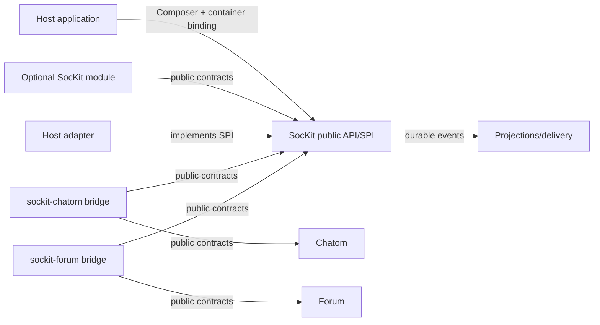
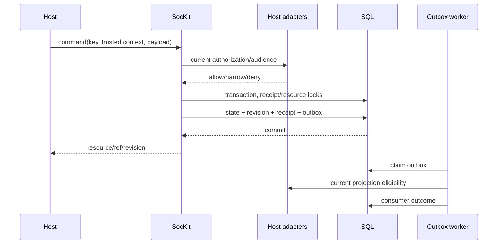
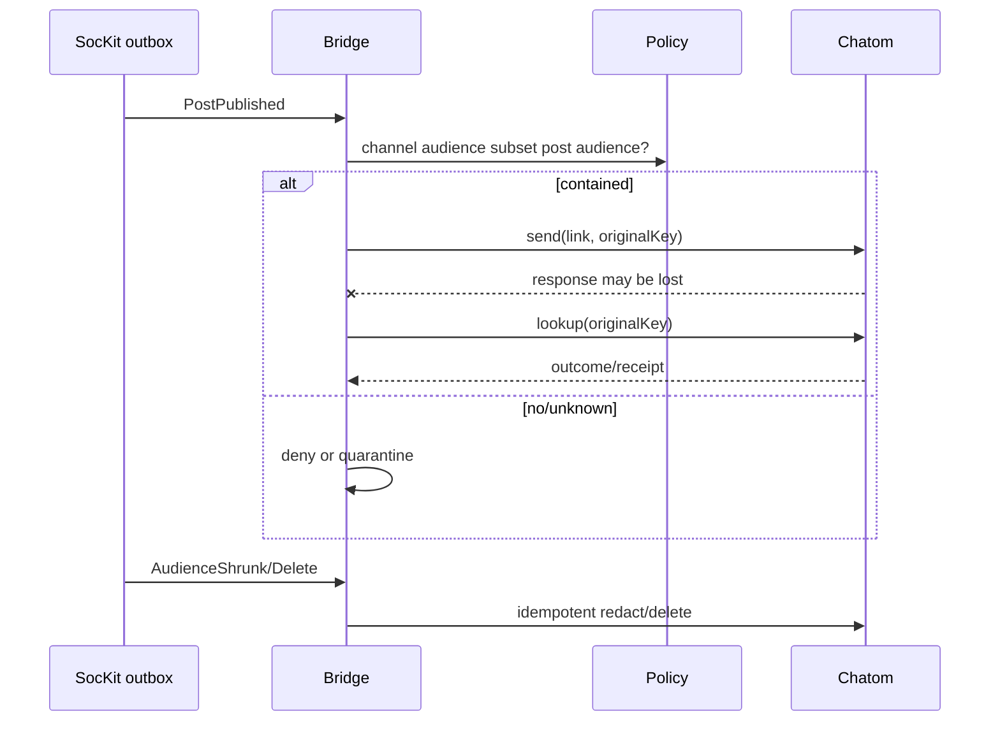
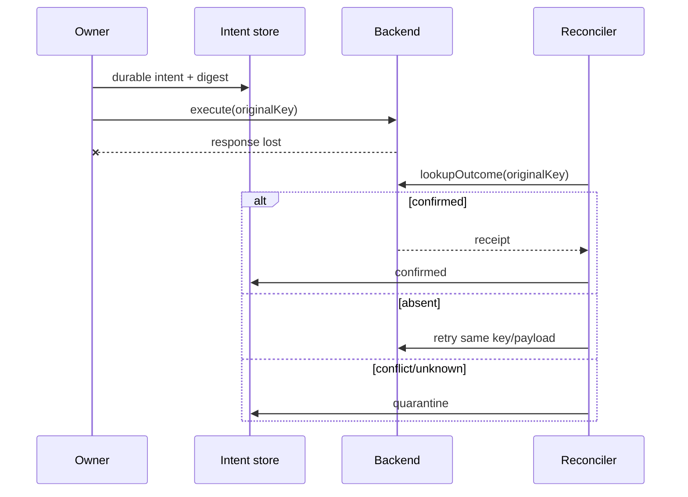

# SocKit — объединённый комплект отчётов

> Первая версия сохранена полностью. Ниже после неё идёт расширенная конкретизация.

## SocKit: архитектурное исследование встраиваемого social-core

**Дата проверки внешних источников:** 17 октября 2026 года.  
**Статус:** восстановленная первая полная версия отчёта.  
**Исходные условия:** SocKit, Edufy, Chatom, Forum и AzGuard описываются по заданию заказчика; внешние решения используются только как референсы.

## 1. Рекомендуемая архитектура и reuse verdict

### Прямой вывод

Рекомендуется разрабатывать собственный встраиваемый `social-core` на PHP/Laravel. Минимальная полезная вертикаль должна включать surfaces, нативные посты, нативные комментарии, социальные реакции, хронологическую ленту, текущую проверку аудитории, revision/CAS, идемпотентные receipts, tombstones и transactional outbox.

Chatom, Forum, поиск, ranking, доставки, UI, admin и клиентские SDK не должны быть обязательными зависимостями ядра. Они подключаются через отдельные адаптеры, мосты и проекции.

Готовые социальные платформы полезны как доноры механизмов, но не подходят как embedded dependency: Flarum, Discourse, NodeBB, Mastodon, HumHub и Fresns владеют собственным приложением, runtime, identity/ACL или инфраструктурой. `cybercog/laravel-love` ближе к библиотеке, но покрывает только реакции и не решает surfaces, posts/comments/feed, trusted actor, current audience, privacy revocation, receipts и lifecycle.

### Пять главных решений

1. **Полезное ядро, а не пустой набор интерфейсов.** Ядро самостоятельно обслуживает publish → feed → comment → reaction.
2. **Current authorization на каждом защищённом выходе.** Feed/search/cache возвращают кандидатов, но не окончательное право доступа.
3. **Один authoritative writer на каждую state identity.** Проекция не становится второй редактируемой копией.
4. **Embedded-first SQL profile.** Domain state, revision, receipt и outbox intent сохраняются одной транзакцией.
5. **Малая типизированная API/SPI-поверхность.** DTO, enums, events и exceptions публичны; ORM, SQL и pipeline остаются `Internal`.

### Сильнейшие возражения

- Current authorization может быть дорогим. Ответ: batch verdict, coarse SQL filtering, generation caches и projection pruning, но не доверие stale projection.
- Receipts/outbox/tombstones выглядят тяжёлыми. Однако без receipt потерянный ответ создаёт duplicate; без tombstone старое событие воскрешает body; без outbox подтверждённая мутация теряет доставку.
- Собственное ядро повторяет социальные платформы. Повторяется функция, но не deployment boundary: SocKit должен встраиваться в чужое Laravel-приложение и принимать host identity/context.

## 2. Матрица референсов

| Кандидат | Тип | Что полезно | Почему не полная dependency |
|---|---|---|---|
| Laravel Love | Composer library, MIT | Reactable-модель, reaction vocabulary | Нет posts/comments/feed/surfaces/current audience/receipts |
| Flarum | PHP forum application/framework, MIT | Extender API, events, policies, query visibility | Владеет форумным runtime и моделями |
| Fresns | Laravel social application, Apache-2.0 | API-first, plugins, content forms | Полноценная платформа с account/theme/plugin subsystems |
| HumHub | PHP/Yii application, AGPL | Spaces/content/modules/permissions | Собственная identity и platform runtime |
| Discourse | Rails application, GPL | Guardian, thread lifecycle, plugin API | Ruby/PostgreSQL/Redis и отдельное приложение |
| NodeBB | Node.js application, GPL | Realtime forum, plugins, DB abstractions | Node runtime и отдельный datastore |
| Mastodon | Rails application, AGPL | Visibility, idempotency, feed fan-out | Federation/Redis/Sidekiq и линейная visibility-модель |
| OpenFGA/Zanzibar | Authorization model/service | Parent-child/object relations | Внешний PDP не нужен как обязательная v1 dependency |
| PostgreSQL | SQL database | Locks, unique indexes, CTE, partial indexes | Выбранная основная production СУБД, не policy engine |

Вывод: внешние проекты использовать как **доноров механизмов**, а не как основу runtime. Любое копирование GPL/AGPL-кода требует отдельной лицензионной оценки.

## 3. Kernel, modules, packages и host

| Элемент | Размещение | Инвариант | Dependency/storage tax | Deletion test |
|---|---|---|---|---|
| Surface registry/lifecycle | Kernel | kind/instance/incarnation однозначны | Таблицы surfaces/bindings | Без него нет безопасной привязки к host entity |
| Trusted actor/context | Kernel + host SPI | Клиентский ID не удостоверяет actor | Обязательный adapter | Без него direct PHP/worker обходят auth |
| Authorization/audience ports | Kernel + host SPI | Unknown fail closed | Adapter calls/cache | Без него privacy невозможна |
| Posts/body/revisions | Kernel | Один writer, revision monotonic | Posts/revisions | Нет публикации |
| Native comments | Kernel | Дерево, revision, tombstone parent | Comments/revisions | Edufy не работает без Chatom |
| Social reactions | Kernel | Unique membership, current visibility | Reactions/counters | Минимальная social vertical неполна |
| Chronological feed | Kernel | Stable cursor, current audience | Индексы | Posts нельзя потреблять как ленту |
| Receipts/outbox/tombstones | Kernel | Retry/replay/delete безопасны | Durable tables/worker | Ломаются failure scenarios |
| Groups | Internal optional module | Не смешиваются с host membership | Membership schema | Class-bound surfaces продолжают работать |
| Ranking/search | Optional projections | Не обходят privacy | Worker/index/service | Chronology остаётся |
| Media | SPI + associations | Bytes принадлежат media owner | Association table | Text-only работает |
| Safety | SPI + content states | Provider verdict отдельно от sanction | Provider/module | Без provider возможен профиль без moderation |
| Chat announcement | `sockit-chatom` bridge | Projection, не comment backend | Mapping/inbox/outbox | Social core работает |
| Chatom/Forum comments | Optional bridge | Immutable backend binding | Migration/reconcile | Native comments работают |
| HTTP/UI/admin/SDK | Delivery tracks | Не второй domain writer | Отдельные packages | PHP API остаётся |
| Identity/membership/consent | Host | Host — source of truth | Host-owned | SocKit не должен заменять |

## 4. Dependency graph и ownership



| State | Writer | Public port | Source of truth |
|---|---|---|---|
| Surface binding/incarnation | SocKit | Surface API | SocKit SQL |
| Native post/comment body | SocKit | Content API | SocKit SQL |
| Social reactions | SocKit | Reaction API | SocKit SQL |
| Host identity/authentication | Host | ActorContext adapter | Host identity system |
| School/class/parent membership | Host | Audience/authorization SPI | Host system |
| Chat message/reaction | Chatom | Chatom public API | Chatom storage |
| Forum topic/vote/accepted answer | Forum | Forum public API | Forum storage |
| Chat-backed comment body | Chatom | Bridge | Chatom; SocKit mapping only |
| Media bytes | Media owner | Media SPI | External storage |
| Safety assessment | Safety provider | Safety SPI | Provider result |
| Notification delivery | Host delivery system | Event consumer | Delivery system |
| Search/ranking | Projection owner | Query provider | Rebuildable projection |

## 5. Surfaces, actor/context и privacy

### Surface identity

Следует разделить:

- **Surface kind** — зарегистрированный тип поведения, например `edufy.class.feed`.
- **Surface instance** — конкретная серверная область, привязанная к `HostEntityRef`.
- **Incarnation** — поколение lifecycle; восстановленный host ID не наследует старый content автоматически.
- **Backend binding** — `native`, `chatom` или `forum`; фиксируется для incarnation.

Внутри SocKit используются обычные FK. Opaque polymorphic reference допустим только на host boundary: `entity_type + entity_value`. Generic polymorphic tables для всех внутренних связей отвергаются из-за отсутствия referential integrity.

### Trusted actor/context

- HTTP middleware создаёт context из authenticated principal и server-side claims.
- Direct PHP caller получает context через trusted factory.
- Queue job передаёт минимальную signed/versioned context reference; worker заново разрешает current admission.
- Service actor имеет отдельный kind и provenance.
- `author_id`, `school_id` и `surface_id` из payload не предоставляют права.

### Audience algebra

Audience — versioned expression/set predicate, а не линейный rank. Базовые формы:

- `Group(id)`;
- `HostScope(type,id)`;
- `InstallationMembers`;
- `Public`;
- `Direct(actorRefs)`;
- `allOf`, `anyOf`, exclusions.

`Class(A)` и `Class(B)` имеют одинаковый уровень строгости, но разные множества readers. Platform minimum ограничивает surface policy; surface может только сузить; content audience задаёт intended audience; current admission пересекается с ней; safety/hold/hide/tombstone запрещают выдачу независимо от membership; commercial entitlement никогда не расширяет privacy.

### Privacy shrink

- Projection возвращает candidate IDs.
- Перед body выполняется current batch authorization.
- Cache key включает actor/context generation и resource privacy revision.
- Search index не является единственным gate.
- Notification worker повторно проверяет доступ.
- Media URL выдаётся короткоживущим broker после current check.
- Уже скачанные bytes отозвать невозможно.

Live membership, archive access и direct grants — разные политики. Их semantics после отзыва должен определить product owner.

### Концептуальная модель

- `surface_kinds`, `surfaces`, `surface_bindings`;
- `posts`, `post_revisions`;
- `comments`, `comment_revisions`;
- `reactions`, `reaction_counts`;
- `audience_specs`, `media_associations`;
- `command_receipts`, `outbox_events`, `consumer_inbox`;
- `resource_tombstones`;
- optional groups/projection cursors/bridge mappings.

Owned IDs — UUIDv7. External IDs сохраняются lossless с namespace.

### Comment tree и feed

V1: adjacency list с `parent_id`, `root_id`, `depth` и ограниченной глубиной. Удалённый parent превращается в non-content tombstone, дети сохраняются.

Feed: fan-out-on-read по `(surface_id, state, published_at, id)` с keyset cursor `(published_at,id)`. Offset pagination не используется. Fan-out-on-write, ranking и search являются optional projections.

### Примеры

| Сценарий | Host передаёт | SocKit хранит |
|---|---|---|
| Edufy class feed | trusted actor, class ref, membership/parent verdict, age band/consent | surface/incarnation, posts/comments/reactions/audience/receipts |
| Article comments | article ref, author/viewer verdict | comment surface, comments/reactions |
| Corporate task | task ref, org context, task ACL verdict | native discussion; optional chat announcement mapping |

## 6. API/SPI и pipeline

### Mutation contract

Команда содержит command key, trusted actor/context, surface/resource, expected revision для edit, versioned payload и action parameters. Payload digest вычисляется внутри SocKit после canonicalization. Namespace включает installation, caller integration и command type.

Result различает `confirmed`, `rejected`, `pending`, `unknown`; содержит receipt, resource ref, revision и typed problem. Outcome query не запускает mutation повторно.

Event содержит event ID, event/schema version, source generation, surface/resource/incarnation, revision/privacy revision и минимальный context envelope. Body, дата рождения, membership list и вечная audience в generic event не помещаются.

### Обязательный pipeline

```text
1. Structural validation
2. Trusted actor/context resolution
3. Surface/incarnation/backend validation
4. Current authorization
5. Audience containment/minimum policy
6. Safety/media preconditions
7. Begin transaction
8. Receipt lookup/lock and digest check
9. Resource lock + revision/state/tombstone recheck
10. Owner-state mutation
11. Receipt + outbox persist
12. Commit
13. Delivery/projection + outcome
```

### Extension slots

| Slot | Семантика | Ошибка | Пример |
|---|---|---|---|
| Authorization/Audience | Mandatory, может veto, не widen | Unknown/deny fail closed | Edufy adapter или AzGuard adapter |
| Formatter | Canonicalize до digest | Invalid format | Plain text/Markdown |
| Safety | До publish или hold | Configured unavailable ≠ success | Edufy moderation |
| Media resolver | Проверяет ref/access | Broken/unauthorized reject | Host storage |
| Ranking | После commit/read projection | Fallback chronology или unavailable | Creator ranking |
| Projection sink | Idempotent outbox consumer | Retry/quarantine | Search/notification |

Config содержит class strings и scalars, валидируется при boot, совместим с `config:cache`; closures и arbitrary callbacks запрещены.

## 7. Comments, reactions, announcements и Forum

### Comments backends

| Backend | Writers | Решение |
|---|---|---|
| Native SocKit | SocKit владеет body/edit/delete/social reactions/association | Default v1 |
| Chatom | Chatom владеет message body/edit/delete/message reactions; SocKit mapping | Optional, нужен idempotency/outcome API |
| Forum | Forum владеет Q&A/votes/accepted answer; Chatom body по текущей модели | Optional после public seam |

Backend binding immutable для surface incarnation. Migration создаёт новое поколение, сохраняет provenance, сверяет revisions/tombstones и переключает reads; постоянный dual-write запрещён.

### Reactions

Social reactions принадлежат SocKit. Chatom reactions принадлежат Chatom. Общими могут быть vocabulary и conformance fixtures; forum votes/rating/accepted answer остаются отдельной семантикой.

Unique DB constraint обеспечивает concurrency invariant. Handler проверяет current visibility/state под lock. Counter — rebuildable projection и не раскрывается unauthorized viewer.

### Announcements

Announcement — projection, не CommentsDriver. Базовый payload: stable link без excerpt/media. Перед send проверяется `audience(channel) ⊆ audience(post)`. Bridge хранит source event digest, mapping, send intent, backend key, outcome/receipt и inbox cursor. Lost response разрешается lookup по исходному key.

### Forum extraction

Рекомендуемый вариант — отдельный Composer package в том же monorepo: public Chatom message/body port, public Forum topic/Q&A port, coordinated CI и compatibility matrix. Отдельный repository добавляет release/migration cost и не меняет body owner автоматически.

## 8. Sequence diagrams

### Native publish/comment



### Chat announcement



### Uncertain external effect



## 9. Failure matrix

| Trigger | Invariant/owner | Observable outcome | Recovery/test |
|---|---|---|---|
| Concurrent same key, lost response | SocKit receipt key+digest | One resource; repeat original; changed payload conflict | Concurrent processes + crash after commit |
| Parallel edit | Expected revision/CAS | One succeeds; one revision conflict | Barrier test |
| Reaction vs hide/delete | Subject lock + unique constraint | No reaction to hidden/deleted; counts private | Opposite lock order test |
| Body saved, outbox fails | One SQL transaction | Whole mutation rollback | Fault injection |
| Draft promotion repeated | Receipt + provenance | One post, current consent rechecked | Lost response test |
| Consent saved, hide failed | Host decision + SocKit effect | Pending application, current reads denied | Reconciler |
| Stale membership projection | Host current admission | Read/write denied | Candidate visible but body denied |
| Class A replaced by B | Set identity, not rank | Former readers removed | Same label/different ref fixture |
| Old event after delete | Tombstone/incarnation/revision | No resurrection | Reordered replay |
| Same event ID/different payload | Inbox digest | Conflict/quarantine | Mutated fixture |
| Chat accept/lost response | Chatom outcome + bridge intent | Original message returned | Lookup test |
| Restore hidden | Current consent/audience/safety | Explicit restore revision | State matrix |
| Old backup/clone | Source generation/high-water marks | Reads closed until reconcile | Restore test |
| Personal-data erasure | Every owner | confirmed/partial/not-implemented explicit | Cross-owner fixture |
| Mixed ID/event formats | Lossless versioned adapter | Unknown fields deny/quarantine | Round-trip fixtures |
| Standalone install | SocKit | Native vertical works | Clean Laravel smoke |

## 10. Релизные уровни

### Edufy v1

- Laravel package, PostgreSQL baseline;
- surface kind/instance/incarnation;
- trusted actor/context;
- authorization/audience adapters;
- native posts/comments/reactions;
- chronological feed;
- draft/pending/published/hidden/deleted/erased;
- revision CAS;
- receipts/tombstones/outbox;
- text format;
- config/migrations/diagnostics;
- без обязательных Chatom, Forum, Redis, Kafka, search, follows, ranking, UI/admin/SDK.

### Creator platform

Public/author surfaces, follows, ranking/search, notification subscriptions, media adapter и moderation. Payments/video/copyright остаются host systems.

### Corporate system

Organization/group adapters, task/CRM surface kinds, guest abilities, archive policy и optional chat announcement. Task ACL остаётся host truth.

### Delivery tracks

HTTP API, TypeScript/Dart SDK, admin и UI — отдельные packages/tracks. Wire schemas и fixtures общие; SDK не становится writer.

## 11. Spikes, риски и отвергнутое

### Decision-changing spikes

1. Audience query benchmark: batch SPI, coarse SQL filter, generation cache.
2. PostgreSQL concurrency: receipts, CAS, reaction/delete, deadlock, outbox crash.
3. Comment tree/feed: adjacency, deleted parent, high-reply thread.
4. Chatom seam audit: idempotency, outcome lookup, event versions, redact/delete.
5. Laravel/PHP support matrix через собранный artifact.

### Open business inputs

- Историческое чтение после исключения из класса.
- Lifetime direct grants.
- Age bands, consent authority, emergency hide.
- Service/institutional authorship.
- Retention/legal hold/restore/erase policy.
- Comment/body/reaction limits и SLO.
- Production DB matrix.
- Open-core license.

### Риски

- Превратить package в универсальную authorization platform.
- Слишком рано создать generic provider framework.
- Построить remote orchestration до реального remote deployment.

Отвергнуты для v1: universal polymorphic social object, mandatory external PDP, event sourcing, Kafka, Redis feed, search cluster, remote SocKit, universal reactions package, dual-write comments, generic workflow engine, mandatory tenant_id, follower graph и framework-free runtime.

## 12. Передача планировщику

### Уже можно принять

- Собственный social-core и native comments/reactions.
- Embedded SQL + PostgreSQL baseline.
- Surface kind/instance/incarnation и immutable backend binding.
- Trusted context и host-owned identity/membership.
- Current audience перед каждым protected output.
- One writer; bridge хранит mappings/intents.
- Receipt key+digest, CAS, tombstone, outbox.
- Api/Spi/Internal boundary.
- Chronological fan-out-on-read v1.

### Проверить локально

- Chatom idempotency namespace, receipt/outcome lookup, delete/redact.
- Chatom event revision/privacy envelope.
- Forum body ownership/imports.
- AzGuard verdict/explain и batch checks.
- Edufy adapter transaction/context coupling.
- Package prefix/release/API tooling.

### Нужен владелец

Business inputs из раздела 11, license, DB support, SLO и scope Chatom bridge.

## Матрица полноты

| Требование | Раздел | Решение |
|---|---|---|
| Constructor products | 3–4 | Kernel + adapters/modules |
| Useful light kernel | 1,3,10 | Native vertical |
| Powerful delivery | 3,10 | Optional projections/tracks |
| Kernel knows no module names | 4,6 | SPI/bridges |
| Invariants not replaceable | 6,9 | Mandatory pipeline + DB constraints |
| Mechanism vs policy | 5,11 | Host defines; SocKit applies |
| Independent install | 3,9,10 | Clean install smoke |
| Similarity ≠ forced reuse | 7 | Separate social/chat/forum semantics |
| Open core/add-ons | 3,11 | No paid privacy flags |
| PHP vs SDK | 10 | Versioned wire; SDK not writer |
| Reliability behavior | 6,8,9 | Receipts/outbox/reconcile |
| Research before plan | 12 | Decisions, checks, owner inputs |
| Surfaces | 5 | kind/instance/incarnation/binding |
| Edufy privacy | 5,9 | Current admission/fail closed |
| All failures | 9 | Explicit matrix |

## Финальная оценка сложности

Слишком сложной архитектура становится, если surface превращается в универсальный resource graph, SPI — в произвольный middleware, а outbox — в remote orchestration platform до появления второго deployment. Нельзя убирать trusted context, current audience, one writer, receipts, tombstones и outbox. Groups, bridges, ranking, search, media implementation, UI и SDK можно отложить без потери первого полезного сценария.

---

## SocKit: детализированная референсная архитектура

**Дата актуализации:** 17 октября 2026 года.  
**Статус:** восстановленная и расширенная вторая версия.  
**Назначение:** конкретизация первой версии до структуры репозитория, классов, контрактов, SQL, тестов и эксплуатации. Примеры являются рекомендуемым baseline, а не замороженным API.

## 1. Архитектурный baseline

SocKit — embedded-first Laravel package. Ядро предоставляет нативные posts, comments, reactions, chronological feed, surfaces, current audience checks, revisions, receipts, tombstones и outbox. Chatom, Forum, ranking, search, media bytes, UI, admin и SDK являются optional delivery/integration tracks.

Главные инварианты:

1. Один authoritative writer на state identity.
2. Trusted actor/context создаётся сервером.
3. Current audience применяется перед каждым protected output.
4. Mutation identity = namespace + command key + canonical payload digest.
5. Domain state, receipt и outbox intent атомарны в embedded profile.
6. Revision/CAS предотвращает lost update.
7. Tombstone/incarnation предотвращают resurrection.
8. Extension может сузить решение, но не отключить обязательную проверку.
9. Projection rebuild не повторяет historical side effects.
10. Public API не выдаёт Eloquent models.

## 2. Структура репозитория

```text
sockit/
├── .github/workflows/
│   ├── ci.yml
│   ├── compatibility.yml
│   └── release.yml
├── config/
│   └── sockit.php
├── database/
│   ├── migrations/
│   │   ├── 0001_01_01_000001_create_sk_surfaces.php
│   │   ├── 0001_01_01_000002_create_sk_content.php
│   │   ├── 0001_01_01_000003_create_sk_reactions.php
│   │   └── 0001_01_01_000004_create_sk_delivery.php
│   └── factories/
├── docs/
│   ├── architecture/
│   │   ├── boundaries.md
│   │   ├── state-ownership.md
│   │   ├── privacy-model.md
│   │   └── failure-semantics.md
│   ├── contracts/
│   │   ├── public-api.md
│   │   ├── host-spi.md
│   │   ├── events.md
│   │   └── problem-codes.md
│   ├── operations/
│   │   ├── installation.md
│   │   ├── outbox.md
│   │   ├── backup-restore.md
│   │   └── erasure.md
│   └── adr/
│       ├── 0001-embedded-first.md
│       ├── 0002-native-comments.md
│       ├── 0003-current-audience.md
│       ├── 0004-command-receipts.md
│       └── 0005-postgresql-baseline.md
├── resources/
│   ├── compatibility/public-api-v1.txt
│   └── schema/
│       ├── events/v1/
│       └── http/v1/
├── src/
│   ├── Api/
│   │   ├── Attribute/
│   │   ├── Command/
│   │   ├── Query/
│   │   ├── Result/
│   │   ├── View/
│   │   ├── Event/
│   │   ├── Exception/
│   │   ├── Enum/
│   │   ├── Value/
│   │   └── SocKit.php
│   ├── Spi/
│   │   ├── Actor/
│   │   ├── Authorization/
│   │   ├── Audience/
│   │   ├── Content/
│   │   ├── Media/
│   │   ├── Safety/
│   │   ├── Projection/
│   │   └── Clock/
│   ├── Internal/
│   │   ├── Application/
│   │   ├── Domain/
│   │   ├── Persistence/
│   │   ├── Delivery/
│   │   ├── Projection/
│   │   ├── Configuration/
│   │   └── Diagnostics/
│   ├── Laravel/
│   │   ├── SocKitServiceProvider.php
│   │   ├── Facades/SocKit.php
│   │   ├── Console/
│   │   ├── Http/
│   │   └── Queue/
│   └── Support/
├── tests/
│   ├── Unit/
│   ├── Integration/Postgres/
│   ├── Concurrency/
│   ├── Contract/HostAdapters/
│   ├── Contract/EventSchemas/
│   ├── Architecture/
│   ├── Compatibility/
│   └── Fixtures/
├── workbench/
├── composer.json
├── phpstan.neon
├── phpunit.xml
├── pint.json
└── rector.php
```

## 3. Namespace и naming rules

- `SocKit\Api` — consumer contracts.
- `SocKit\Spi` — host/extension implementations.
- `SocKit\Internal` — private implementation.
- `SocKit\Laravel` — integration layer.
- `SocKit\Support` — только действительно нейтральные малые utilities.

Naming:

- `PublishPostCommand`, `PublishPostHandler`, `MutationResult`.
- `GetFeedQuery`, `FeedPageView`.
- `PostPublished`, `CommentEdited` — завершённые факты.
- `AudienceDecider`, `ContentSafetyProvider` — capability names.
- Избегать `Manager`, `Helper`, `Util`, `BaseService`.
- Eloquent records: `PostRecord`, `CommentRecord`; не путать с domain entities.
- Repository interfaces не публиковать в API без внешнего потребителя.

## 4. composer.json

```json
{
  "name": "vendor/sockit",
  "description": "Embeddable social core for Laravel applications",
  "type": "library",
  "license": "MIT",
  "require": {
    "php": "^8.4",
    "illuminate/container": "^13.0",
    "illuminate/contracts": "^13.0",
    "illuminate/database": "^13.0",
    "illuminate/events": "^13.0",
    "illuminate/support": "^13.0",
    "psr/clock": "^1.0",
    "psr/log": "^3.0"
  },
  "require-dev": {
    "larastan/larastan": "^3.0",
    "orchestra/testbench": "^11.0",
    "pestphp/pest": "^4.0",
    "phpstan/phpstan": "^2.0"
  },
  "autoload": {
    "psr-4": {"SocKit\\": "src/"}
  },
  "autoload-dev": {
    "psr-4": {"SocKit\\Tests\\": "tests/"}
  },
  "extra": {
    "laravel": {
      "providers": ["SocKit\\Laravel\\SocKitServiceProvider"]
    }
  }
}
```

Точные dev dependency versions проверяются при bootstrap. Public ID value objects не должны раскрывать выбранную UUID-библиотеку.

## 5. Конфигурация

```php
return [
    'connection' => env('SOCKIT_DB_CONNECTION'),
    'table_prefix' => 'sk_',

    'ids' => ['strategy' => 'uuid_v7'],

    'content' => [
        'max_body_bytes' => 65_536,
        'comment_max_depth' => 8,
        'default_format' => 'plain_text',
    ],

    'feed' => [
        'default_page_size' => 20,
        'maximum_page_size' => 100,
        'candidate_oversampling_factor' => 3,
        'maximum_refill_rounds' => 4,
    ],

    'outbox' => [
        'batch_size' => 100,
        'lease_seconds' => 60,
        'max_attempts' => 20,
    ],

    'drivers' => [
        'actor_context' => App\SocKit\EdufyActorContextResolver::class,
        'authorization' => App\SocKit\EdufyAuthorizationDecider::class,
        'audience' => App\SocKit\EdufyAudienceDecider::class,
        'safety' => SocKit\Internal\Safety\DisabledSafetyProvider::class,
        'media' => SocKit\Internal\Media\RejectAllMediaResolver::class,
    ],
];
```

Только scalars, arrays и class strings. Closures, objects и runtime callbacks запрещены. `DisabledSafetyProvider` допустим только для surface без обязательной moderation capability.

## 6. Service provider

```php
final class SocKitServiceProvider extends ServiceProvider
{
    public function register(): void
    {
        $this->mergeConfigFrom(__DIR__.'/../../config/sockit.php', 'sockit');

        $this->app->singleton(
            \SocKit\Api\SocKit::class,
            \SocKit\Internal\Application\InternalSocKit::class,
        );

        $this->app->singleton(
            TypedSocKitConfig::class,
            fn (Application $app) => ConfigFactory::fromArray(
                $app['config']->get('sockit', []),
            ),
        );

        $this->registerHostDrivers();
        $this->registerRepositories();
        $this->registerHandlers();
    }

    public function boot(): void
    {
        $this->app->make(TypedSocKitConfig::class)->assertValid();

        $this->publishes([
            __DIR__.'/../../config/sockit.php' => config_path('sockit.php'),
        ], 'sockit-config');

        $this->publishesMigrations([
            __DIR__.'/../../database/migrations' => database_path('migrations'),
        ]);

        if ($this->app->runningInConsole()) {
            $this->commands([
                OutboxRunCommand::class,
                OutboxInspectCommand::class,
                RebuildReactionCountsCommand::class,
                DiagnoseInstallationCommand::class,
            ]);
        }
    }
}
```

Tagged services разрешены для additive projection consumers. Security stages не собираются произвольным tag order.

## 7. Attributes и public boundary

```php
#[Attribute(Attribute::TARGET_CLASS | Attribute::TARGET_METHOD)]
final class Api {}

#[Attribute(Attribute::TARGET_CLASS)]
final class Spi {}
```

Attributes — документация и input для architecture tests; сами по себе не обеспечивают совместимость.

Architecture checks:

- `Api` не импортирует `Internal`.
- `Spi` не импортирует `Internal`.
- Public signatures не содержат Eloquent/Builder/Request/Response.
- `Internal` classes не отмечаются `Api`.
- Host workbench не импортирует `Internal`.

## 8. Value objects

### CommandKey

```php
#[Api]
final readonly class CommandKey
{
    private function __construct(public string $value) {}

    public static function fromString(string $value): self
    {
        $value = trim($value);

        if (!preg_match('/^[A-Za-z0-9][A-Za-z0-9._:-]{15,127}$/', $value)) {
            throw InvalidCommandKey::becauseFormatIsInvalid();
        }

        return new self($value);
    }
}
```

Ключ сохраняется между retries. Namespace формируется сервером из installation, caller integration и command type.

### HostEntityRef

```php
#[Api]
final readonly class HostEntityRef
{
    public function __construct(
        public string $type,
        public string $value,
    ) {
        if ($type === '' || strlen($type) > 96) {
            throw InvalidHostEntityRef::invalidType();
        }
        if ($value === '' || strlen($value) > 512) {
            throw InvalidHostEntityRef::invalidValue();
        }
    }
}
```

External ID хранится lossless. Дополнительный hash может ускорять lookup, но не заменяет canonical value.

### Revision

```php
#[Api]
final readonly class Revision
{
    public function __construct(public int $value)
    {
        if ($value < 1) {
            throw InvalidRevision::mustBePositive();
        }
    }

    public function next(): self
    {
        return new self($this->value + 1);
    }
}
```

## 9. Public command/result

```php
#[Api]
final readonly class PublishPostCommand
{
    public function __construct(
        public CommandKey $commandKey,
        public TrustedActorContext $actor,
        public SurfaceId $surfaceId,
        public BodyInput $body,
        public AudienceInput $audience,
        public ?HostEntityRef $source = null,
        public array $metadata = [],
    ) {}
}
```

```php
enum MutationStatus: string
{
    case Confirmed = 'confirmed';
    case Rejected = 'rejected';
    case Pending = 'pending';
    case Unknown = 'unknown';
}

#[Api]
final readonly class MutationResult
{
    public function __construct(
        public MutationStatus $status,
        public ReceiptId $receiptId,
        public ?ResourceRef $resource,
        public ?Revision $revision,
        public ?Problem $problem,
    ) {}
}
```

Repeat same key+digest returns original result after current authorization. Same key+different digest returns `sockit.idempotency_conflict`.

## 10. Host SPI

```php
#[Spi]
interface ActorContextResolver
{
    public function resolve(TrustedInvocation $invocation): TrustedActorContext;
}

#[Spi]
interface AuthorizationDecider
{
    public function decide(ActionRequest $request): AuthorizationDecision;
}

#[Spi]
interface AudienceDecider
{
    public function decideRead(ReadAudienceRequest $request): AudienceDecision;

    public function assertCanPublish(
        PublishAudienceRequest $request,
    ): PublishAudienceDecision;
}

#[Spi]
interface BatchAudienceDecider extends AudienceDecider
{
    /** @return array<string, AudienceDecision> */
    public function decideMany(BatchReadAudienceRequest $request): array;
}
```

Decision содержит allow/deny/unknown, stable reason code, policy version/generation и optional expiry. Unknown fail closed. Explain не раскрывает существование скрытого content.

## 11. Surface registration

```php
final class EdufySocKitServiceProvider extends ServiceProvider
{
    public function boot(SurfaceKindRegistry $registry): void
    {
        $registry->register(new SurfaceKindDefinition(
            key: SurfaceKindKey::fromString('edufy.class.feed'),
            capabilities: CapabilitySet::of(
                Capability::Posts,
                Capability::Comments,
                Capability::Reactions,
            ),
            minimumAudience: AudienceConstraint::hostScope('class'),
            commentBackend: CommentBackend::Native,
            contentFormat: ContentFormatKey::fromString('plain_text'),
        ));
    }
}
```

Conflict same key/different digest — boot error. Same key/same digest — idempotent registration.

```php
$result = $socKit->surfaces()->create(new CreateSurfaceCommand(
    commandKey: CommandKey::fromString($requestId),
    actor: $trustedContext,
    kind: SurfaceKindKey::fromString('edufy.class.feed'),
    hostEntity: new HostEntityRef('edufy.class', (string) $class->id),
    audience: AudienceInput::hostScope('class', (string) $class->id),
));
```

## 12. Content state machine

```php
enum ContentState: string
{
    case Draft = 'draft';
    case PendingReview = 'pending_review';
    case Published = 'published';
    case Hidden = 'hidden';
    case Deleted = 'deleted';
    case Erased = 'erased';
}
```

```text
draft -> pending_review -> published
  |             |             |
  +-> deleted   +-> deleted   +-> hidden -> published
                                  |           |
                                  +-> deleted +-> erased
published -> deleted -> erased
```

Retention hold — отдельное состояние/record, способное сосуществовать с hidden/deleted. Restore — новая mutation с текущими consent/audience/safety checks. Erased body обычным restore не возвращается.

## 13. Application pipeline

```text
1. Decode and structural validation
2. Resolve trusted actor/context
3. Validate surface/incarnation/backend
4. Current authorization
5. Audience containment/minimum policy
6. Safety/media preconditions
7. Begin SQL transaction
8. Lock/lookup command receipt
9. Compare canonical payload digest
10. Lock resource and recheck state/revision/tombstone
11. Apply owner mutation
12. Save receipt and outbox
13. Commit
14. Asynchronous delivery/projection
```

Remote network call внутри SQL transaction запрещён. Pre-transaction remote verdict должен иметь version/generation token, повторно проверяемый локально, или mutation оформляется как durable intent workflow.

## 14. Publish handler

```php
final class PublishPostHandler
{
    public function __construct(
        private ConnectionInterface $db,
        private ReceiptRepository $receipts,
        private SurfaceRepository $surfaces,
        private PostRepository $posts,
        private OutboxRepository $outbox,
        private AuthorizationDecider $authorization,
        private AudienceDecider $audience,
        private CanonicalPayloadHasher $hasher,
        private ClockInterface $clock,
        private IdGenerator $ids,
    ) {}

    public function handle(PublishPostCommand $command): MutationResult
    {
        $surface = $this->surfaces->getActive($command->surfaceId);

        $this->authorization->decide(
            ActionRequest::publishPost($command->actor, $surface),
        )->requireAllowed();

        $audience = $this->audience->assertCanPublish(
            PublishAudienceRequest::from($command, $surface),
        )->audience;

        $canonical = CanonicalPublishPayload::from($command, $audience);
        $digest = $this->hasher->hash($canonical);

        return $this->db->transaction(function () use (
            $command, $surface, $audience, $canonical, $digest
        ) {
            $existing = $this->receipts->lockByCommand(
                CommandNamespace::for($command, $surface),
                $command->commandKey,
            );

            if ($existing !== null) {
                return $existing->replayOrConflict($digest);
            }

            $surface = $this->surfaces->lockActiveIncarnation($surface->id);

            $post = Post::publish(
                id: $this->ids->postId(),
                surface: $surface,
                author: $command->actor->actor,
                body: $canonical->body,
                audience: $audience,
                now: $this->clock->now(),
            );

            $this->posts->insert($post);

            $event = PostPublished::fromPost(
                eventId: $this->ids->eventId(),
                post: $post,
            );

            $receipt = MutationReceipt::confirmed(
                receiptId: $this->ids->receiptId(),
                command: $command,
                digest: $digest,
                resource: $post->ref(),
                revision: $post->revision(),
                now: $this->clock->now(),
            );

            $this->receipts->insert($receipt);
            $this->outbox->append($event);

            return $receipt->toResult();
        }, attempts: 3);
    }
}
```

## 15. SQL: receipts

```sql
CREATE TABLE sk_command_receipts (
    id uuid PRIMARY KEY,
    command_namespace varchar(160) NOT NULL,
    command_key varchar(128) NOT NULL,
    command_type varchar(120) NOT NULL,
    payload_digest char(64) NOT NULL,
    status varchar(24) NOT NULL,
    resource_type varchar(64),
    resource_id uuid,
    applied_revision bigint,
    problem_code varchar(96),
    result_payload jsonb NOT NULL,
    created_at timestamptz NOT NULL,
    completed_at timestamptz,
    UNIQUE (command_namespace, command_key)
);
```

`result_payload` — stable minimal result, не ORM serialization. Receipt retention не короче retry/replay/backup horizon.

## 16. SQL: surfaces

```sql
CREATE TABLE sk_surfaces (
    id uuid PRIMARY KEY,
    kind varchar(160) NOT NULL,
    host_entity_type varchar(96) NOT NULL,
    host_entity_value varchar(512) NOT NULL,
    incarnation bigint NOT NULL,
    lifecycle_state varchar(32) NOT NULL,
    audience_spec_id uuid,
    created_at timestamptz NOT NULL,
    archived_at timestamptz,
    UNIQUE (kind, host_entity_type, host_entity_value, incarnation)
);

CREATE TABLE sk_surface_bindings (
    surface_id uuid NOT NULL REFERENCES sk_surfaces(id),
    incarnation bigint NOT NULL,
    backend varchar(64) NOT NULL,
    backend_config_version smallint NOT NULL,
    binding_digest char(64) NOT NULL,
    created_at timestamptz NOT NULL,
    PRIMARY KEY (surface_id, incarnation)
);
```

Binding не меняется config flip. Migration создаёт новое generation/incarnation или explicit binding migration record.

## 17. SQL: posts/revisions

```sql
CREATE TABLE sk_posts (
    id uuid PRIMARY KEY,
    surface_id uuid NOT NULL REFERENCES sk_surfaces(id),
    surface_incarnation bigint NOT NULL,
    author_type varchar(64) NOT NULL,
    author_id varchar(512) NOT NULL,
    state varchar(32) NOT NULL,
    body_format varchar(48) NOT NULL,
    current_body text,
    revision bigint NOT NULL,
    privacy_revision bigint NOT NULL,
    audience_spec_id uuid NOT NULL,
    published_at timestamptz,
    hidden_at timestamptz,
    deleted_at timestamptz,
    erased_at timestamptz,
    created_at timestamptz NOT NULL,
    updated_at timestamptz NOT NULL,
    CHECK (revision >= 1),
    CHECK (privacy_revision >= 1),
    CHECK ((state <> 'erased') OR current_body IS NULL)
);

CREATE INDEX sk_posts_surface_feed_idx
    ON sk_posts (surface_id, published_at DESC, id DESC)
    WHERE state = 'published';
```

```sql
CREATE TABLE sk_post_revisions (
    post_id uuid NOT NULL REFERENCES sk_posts(id),
    revision bigint NOT NULL,
    state varchar(32) NOT NULL,
    body_format varchar(48) NOT NULL,
    body text,
    audience_spec_id uuid NOT NULL,
    actor_type varchar(64) NOT NULL,
    actor_id varchar(512) NOT NULL,
    reason_code varchar(96),
    recorded_at timestamptz NOT NULL,
    PRIMARY KEY (post_id, revision)
);
```

Erase workflow удаляет revision bodies по policy, оставляя минимальный audit digest/state transition.

## 18. SQL: comments

```sql
CREATE TABLE sk_comments (
    id uuid PRIMARY KEY,
    post_id uuid NOT NULL REFERENCES sk_posts(id),
    parent_id uuid REFERENCES sk_comments(id),
    root_id uuid NOT NULL,
    depth smallint NOT NULL,
    author_type varchar(64) NOT NULL,
    author_id varchar(512) NOT NULL,
    state varchar(32) NOT NULL,
    current_body text,
    revision bigint NOT NULL,
    privacy_revision bigint NOT NULL,
    created_at timestamptz NOT NULL,
    updated_at timestamptz NOT NULL,
    deleted_at timestamptz,
    CHECK (depth >= 0),
    CHECK (revision >= 1)
);

CREATE INDEX sk_comments_thread_idx
    ON sk_comments (post_id, root_id, created_at, id);
```

Handler под lock проверяет, что parent относится к тому же post, и рассчитывает depth. Deleted parent сохраняет structural tombstone.

## 19. CAS editing

```sql
UPDATE sk_comments
SET current_body = :body,
    revision = revision + 1,
    updated_at = :now
WHERE id = :id
  AND revision = :expected_revision
  AND state IN ('published', 'hidden')
RETURNING id, revision;
```

Ноль rows разрешается safe follow-up lookup с anti-enumeration policy. Нельзя автоматически повторять edit поверх новой revision.

## 20. SQL: reactions

```sql
CREATE TABLE sk_reactions (
    id uuid PRIMARY KEY,
    subject_type varchar(32) NOT NULL,
    subject_id uuid NOT NULL,
    actor_type varchar(64) NOT NULL,
    actor_id varchar(512) NOT NULL,
    reaction_type varchar(64) NOT NULL,
    created_at timestamptz NOT NULL,
    UNIQUE (subject_type, subject_id, actor_type, actor_id, reaction_type)
);
```

Если policy допускает только одну reaction на subject, `reaction_type` удаляется из unique key. Смена — deterministic replace в одной transaction.

```sql
CREATE TABLE sk_reaction_counts (
    subject_type varchar(32) NOT NULL,
    subject_id uuid NOT NULL,
    reaction_type varchar(64) NOT NULL,
    count bigint NOT NULL,
    source_revision bigint NOT NULL,
    PRIMARY KEY (subject_type, subject_id, reaction_type),
    CHECK (count >= 0)
);
```

Counter rebuildable; negative count — invariant violation, не значение для silent clamp.

## 21. Feed cursor и pagination

```php
final readonly class FeedCursorPayload
{
    public function __construct(
        public DateTimeImmutable $publishedAt,
        public PostId $postId,
        public SurfaceId $surfaceId,
        public int $queryVersion,
    ) {}
}
```

Cursor сериализуется canonical JSON/base64url и подписывается MAC. Raw client SQL values запрещены.

```sql
SELECT id, published_at, privacy_revision
FROM sk_posts
WHERE surface_id = :surface_id
  AND state = 'published'
  AND (published_at, id) < (:cursor_time, :cursor_id)
ORDER BY published_at DESC, id DESC
LIMIT :candidate_limit;
```

После batch audience filtering kernel делает bounded refill. Next cursor строится по последнему просмотренному candidate, а не последнему visible row.

## 22. SQL: outbox

```sql
CREATE TABLE sk_outbox_events (
    id uuid PRIMARY KEY,
    aggregate_type varchar(64) NOT NULL,
    aggregate_id uuid NOT NULL,
    aggregate_revision bigint NOT NULL,
    event_type varchar(160) NOT NULL,
    event_schema_version smallint NOT NULL,
    payload_digest char(64) NOT NULL,
    payload jsonb NOT NULL,
    occurred_at timestamptz NOT NULL,
    available_at timestamptz NOT NULL,
    attempts integer NOT NULL DEFAULT 0,
    lease_owner varchar(128),
    lease_until timestamptz,
    delivered_at timestamptz,
    last_problem_code varchar(96),
    UNIQUE (aggregate_type, aggregate_id, aggregate_revision, event_type)
);
```

Claim:

```sql
WITH claimed AS (
    SELECT id
    FROM sk_outbox_events
    WHERE delivered_at IS NULL
      AND available_at <= now()
      AND (lease_until IS NULL OR lease_until < now())
    ORDER BY occurred_at, id
    FOR UPDATE SKIP LOCKED
    LIMIT :batch_size
)
UPDATE sk_outbox_events e
SET lease_owner = :worker_id,
    lease_until = now() + :lease_interval,
    attempts = attempts + 1
FROM claimed
WHERE e.id = claimed.id
RETURNING e.*;
```

Queue uniqueness — оптимизация, не correctness boundary. Истина — outbox row + consumer inbox unique key.

## 23. Event envelope

```json
{
  "event_id": "019...",
  "event_type": "sockit.post.published",
  "schema_version": 1,
  "source": {
    "installation": "opaque-installation-id",
    "generation": "019..."
  },
  "aggregate": {
    "type": "post",
    "id": "019...",
    "revision": 1,
    "privacy_revision": 1
  },
  "surface": {
    "id": "019...",
    "incarnation": 3
  },
  "occurred_at": "2026-10-17T11:30:00.000000Z",
  "context": {
    "audience_spec_id": "019...",
    "body_available": true
  }
}
```

Generic event не содержит body, DOB, membership list или direct recipients. Authorized projector получает snapshot через owner API.

## 24. Consumer inbox

```sql
CREATE TABLE sk_consumer_inbox (
    consumer varchar(160) NOT NULL,
    event_id uuid NOT NULL,
    payload_digest char(64) NOT NULL,
    source_generation uuid NOT NULL,
    outcome varchar(24) NOT NULL,
    processed_at timestamptz,
    problem_code varchar(96),
    PRIMARY KEY (consumer, event_id)
);
```

Same event/same digest returns original outcome. Same event/different digest = conflict/quarantine.

## 25. Audience evaluation

```php
final readonly class ReadAudienceRequest
{
    public function __construct(
        public TrustedActorContext $actor,
        public SurfaceRef $surface,
        public ResourceRef $resource,
        public AudienceSpecRef $audience,
        public PrivacyRevision $privacyRevision,
    ) {}
}
```

Cache key:

```text
sockit:audience:v1:
  actor=<opaque actor digest>:
  context_generation=<host generation>:
  resource=<type/id>:
  privacy_revision=<n>:
  policy_version=<v>
```

Cache miss/timeout = unknown/deny unless explicit safe local fallback. Positive cache TTL должен быть коротким и/или generation-invalidated. Negative cache допустим дольше, если не ломает новые grants.

## 26. Edufy adapter example

```php
final class EdufyAudienceDecider implements BatchAudienceDecider
{
    public function __construct(
        private CurrentEnrollmentGateway $enrollments,
        private ParentObservationGateway $parents,
        private ConsentGateway $consents,
    ) {}

    public function decideRead(ReadAudienceRequest $request): AudienceDecision
    {
        $actor = $request->actor;
        $scope = $request->audience->requireHostScope('class');

        if ($actor->ageBand->isUnknownMinorContext()) {
            return AudienceDecision::deny('unknown_age_conservative');
        }

        if ($this->enrollments->isCurrentMember($actor->actor, $scope)) {
            return AudienceDecision::allow('current_class_member');
        }

        if ($this->parents->mayObserve($actor->actor, $scope)) {
            return AudienceDecision::allowReadOnly('parent_observer');
        }

        return AudienceDecision::deny('not_currently_admitted');
    }
}
```

Parent observer decision не используется для write command. Consent/safety checks отделены от membership.

## 27. Chatom bridge

```text
sockit-chatom/
├── src/Api/
├── src/Internal/Announcement/
├── src/Internal/CommentBackend/
├── src/Internal/Mapping/
├── src/Internal/Reconciliation/
├── src/Laravel/
├── database/migrations/
└── tests/Contract/
```

```sql
CREATE TABLE scb_announcement_mappings (
    id uuid PRIMARY KEY,
    sockit_post_id uuid NOT NULL,
    sockit_incarnation bigint NOT NULL,
    chatom_channel_id varchar(512) NOT NULL,
    chatom_message_id varchar(512),
    source_privacy_revision bigint NOT NULL,
    backend_receipt varchar(512),
    state varchar(32) NOT NULL,
    UNIQUE (sockit_post_id, sockit_incarnation, chatom_channel_id)
);
```

Workflow:

1. Consume event through bridge inbox.
2. Resolve current authorized post snapshot.
3. Resolve current channel audience.
4. Verify containment.
5. Persist send intent/stable backend key.
6. Call Chatom outside SocKit transaction.
7. On timeout call outcome lookup with same key.
8. Store mapping/receipt.
9. Process shrink/delete as redact/delete intent.
10. Reject stale event by privacy revision/tombstone.

Если Chatom не имеет idempotency/outcome lookup, bridge нельзя объявлять exactly-once-effect. Допустима честно описанная at-least-once доставка или отказ от production bridge.

## 28. HTTP adapter

```php
final class PublishPostController
{
    public function __invoke(
        PublishPostRequest $request,
        SocKit $socKit,
        HttpActorContextFactory $actors,
    ): JsonResponse {
        $actor = $actors->fromRequest($request);

        $key = $request->header('Idempotency-Key');
        if ($key === null) {
            throw MissingIdempotencyKey::new();
        }

        $result = $socKit->posts()->publish(
            PublishPostCommand::fromHttp(
                request: $request,
                actor: $actor,
                commandKey: CommandKey::fromString($key),
            ),
        );

        return MutationResponseMapper::toJson($result);
    }
}
```

Domain handler не читает global `request()`, `auth()` или facade. Rate limit является transport concern, не domain authorization.

## 29. Problem response и codes

```json
{
  "type": "https://example.test/problems/sockit/revision-conflict",
  "title": "Revision conflict",
  "status": 409,
  "code": "sockit.revision_conflict",
  "trace_id": "...",
  "meta": {"current_revision": 8}
}
```

Stable codes:

```text
sockit.authentication_required
sockit.actor_context_invalid
sockit.authorization_denied
sockit.authorization_unknown
sockit.surface_not_found
sockit.surface_archived
sockit.surface_incarnation_mismatch
sockit.backend_binding_mismatch
sockit.audience_not_contained
sockit.audience_version_unknown
sockit.content_held
sockit.content_hidden
sockit.content_deleted
sockit.content_erased
sockit.revision_conflict
sockit.idempotency_conflict
sockit.provider_unavailable
sockit.external_outcome_unknown
sockit.event_identity_conflict
sockit.configuration_invalid
```

Exception messages не являются machine contract.

## 30. Config validation

Проверяются:

- DB connection/profile;
- prefix whitelist;
- class existence и SPI implementation;
- обязательные providers по capabilities;
- limits ranges;
- backend key uniqueness;
- consumer name uniqueness;
- config cache serialization;
- migration/schema compatibility.

Ошибка возникает при boot/diagnose, не при первой production mutation.

## 31. Security boundaries

Запрещено:

- выдавать Eloquent models публично;
- mass-assign request в model;
- проверять authorization только в controller;
- доверять `author_id`/`school_id`/`surface_id`;
- логировать body/audience/member list;
- выдавать permanent media URLs;
- позволять host писать package tables;
- импортировать `Internal` из bridge;
- трактовать cache miss как allow;
- считать search result правом;
- разрешать arbitrary extension callback менять deny на allow.

## 32. Logging и metrics

```php
$logger->info('sockit.mutation.completed', [
    'sockit.command.type' => 'publish_post',
    'sockit.command.key_hash' => $keyHasher->forLog($commandKey),
    'sockit.receipt.id' => (string) $receiptId,
    'sockit.surface.kind' => $surfaceKind->value,
    'sockit.outcome' => 'confirmed',
    'sockit.revision' => 1,
    'trace_id' => $traceContext->traceId(),
]);
```

Не логируются raw key, body, display name, recipient list и credentials.

Metrics:

```text
sockit_mutation_duration_seconds{command,outcome}
sockit_authorization_decisions_total{action,decision,reason_family}
sockit_receipt_conflicts_total{command}
sockit_outbox_oldest_age_seconds{consumer}
sockit_outbox_attempts_total{consumer,outcome}
sockit_projection_lag_seconds{projection}
sockit_feed_candidates_total{surface_kind}
sockit_feed_visible_total{surface_kind}
sockit_revision_conflicts_total{resource_type}
```

IDs не используются как metric labels.

## 33. Operations commands

```text
php artisan sockit:diagnose
php artisan sockit:outbox:run --once --batch=100
php artisan sockit:outbox:inspect --older-than=5m
php artisan sockit:outbox:retry <event-id>
php artisan sockit:reactions:rebuild --subject=post:<id>
php artisan sockit:projection:rebuild <projection>
php artisan sockit:tombstones:verify
php artisan sockit:receipts:verify
php artisan sockit:surface:inspect <surface-id>
```

Projection rebuild использует `ReplayMode::ProjectionOnly` и не рассылает historical notifications.

## 34. Backup, restore и clone

Installation имеет `source_generation_id`.

Restore in place:

1. schema check;
2. source generation check;
3. tombstone high-water reconciliation;
4. receipt/outbox/inbox consistency;
5. projection rebuild;
6. explicit read unlock.

Clone/staging получает новый generation; outbound delivery disabled по умолчанию. Иначе clone может повторить production notifications.

## 35. Erasure

```php
enum ErasureOutcome: string
{
    case Confirmed = 'confirmed';
    case PartiallyCompleted = 'partially_completed';
    case NotImplemented = 'not_implemented';
    case BlockedByRetentionHold = 'blocked_by_retention_hold';
    case FailedRetryable = 'failed_retryable';
    case FailedPermanent = 'failed_permanent';
}
```

Host orchestrator отдельно вызывает SocKit, media, search, notifications и bridges. Partial/not-implemented не агрегируется как success.

## 36. Tests

```text
tests/
├── Unit/
│   ├── Domain/PostTest.php
│   ├── Domain/CommentTest.php
│   ├── Audience/AudienceExpressionTest.php
│   └── Idempotency/CanonicalPayloadHasherTest.php
├── Integration/Postgres/
│   ├── PublishPostHandlerTest.php
│   ├── EditCommentCasTest.php
│   ├── OutboxClaimTest.php
│   └── TombstoneReplayTest.php
├── Concurrency/
│   ├── DuplicatePublishTest.php
│   ├── ConcurrentCommentEditTest.php
│   ├── ReactionVersusHideTest.php
│   └── OutboxWorkersTest.php
├── Contract/HostAdapters/
│   ├── AudienceDeciderContract.php
│   └── AuthorizationDeciderContract.php
├── Architecture/
│   ├── PublicApiBoundaryTest.php
│   ├── NoInternalImportsTest.php
│   └── NoEloquentInApiTest.php
└── Compatibility/
    ├── PublicSymbolsSnapshotTest.php
    ├── EventFixtureTest.php
    └── MigrationUpgradeTest.php
```

Concurrency test использует независимые DB connections/processes:

```php
it('returns one post for concurrent identical commands', function () {
    $barrier = ProcessBarrier::forParticipants(2);
    $command = Fixtures::publishPost(
        commandKey: 'test.concurrent.publish.0001',
    );

    $results = Concurrently::run([
        fn () => $this->newProcessClient($barrier)->publish($command),
        fn () => $this->newProcessClient($barrier)->publish($command),
    ]);

    expect(PostRecord::query()->count())->toBe(1)
        ->and($results[0]->resource)->toEqual($results[1]->resource)
        ->and(ReceiptRecord::query()->count())->toBe(1);
});
```

SQLite не доказывает PostgreSQL locking/partial indexes/concurrency.

## 37. Adapter contract suite

Каждый AudienceDecider проходит:

- unknown actor/context/version → deny/unknown;
- direct grant не даёт write;
- class A ≠ class B;
- membership removal закрывает current read;
- parent observer read не даёт comment write;
- surface minimum нельзя ослабить;
- batch/scalar эквивалентны;
- explain не раскрывает hidden body.

## 38. CI matrix

```yaml
strategy:
  matrix:
    php: ['8.4', '8.5']
    laravel: ['13.*']
    postgres: ['17', '18']
```

Stages:

1. Composer validate.
2. Lowest/highest dependencies.
3. Style.
4. PHPStan.
5. Unit/integration.
6. PostgreSQL concurrency.
7. Architecture/API checks.
8. Fresh and upgrade migrations.
9. Build package archive.
10. Install archive into clean host.
11. `config:cache`, migrate, diagnose, smoke.

## 39. Compatibility

Отдельно versioned:

- PHP application API;
- SPI;
- HTTP/wire;
- events;
- DB schema;
- config schema.

`public-api-v1.txt` содержит FQCN, constructors/methods, parameter/return types, enum cases и attributes. Required constructor parameter, method removal или type narrowing — breaking. Новая enum case может ломать exhaustive match.

SPI расширяется capability interface, а не новым method в стабильном interface:

```php
interface AudienceDeciderV1 {}
interface SupportsBatchAudienceDecisions {}
```

## 40. Documentation requirements

Каждый command документирует:

- trusted inputs;
- state owner;
- authorization timing;
- idempotency namespace/digest;
- transaction boundary;
- revision semantics;
- emitted events;
- problem codes;
- retry guidance;
- PII/logging.

Каждый SPI документирует:

- caller/frequency;
- transaction context;
- timeout/retry;
- veto authority;
- fail-open/fail-closed;
- cacheability/version;
- batch capability;
- compatibility.

## 41. ADR baseline

- ADR-0001 Embedded-first.
- ADR-0002 Native comments.
- ADR-0003 Current audience.
- ADR-0004 Command receipts.
- ADR-0005 Transactional outbox.
- ADR-0006 Surface identity.
- ADR-0007 PostgreSQL baseline.
- ADR-0008 Api/Spi/Internal.
- ADR-0009 Body ownership.
- ADR-0010 Deletion semantics.

## 42. Implementation dependency order

1. Value objects/problem taxonomy/boundary tests.
2. Typed config/install smoke.
3. Surface identity.
4. Trusted context and host contract tests.
5. Receipts/canonical digest.
6. Posts/revisions/outbox transaction.
7. Feed/current audience.
8. Comments/CAS.
9. Reactions/counters.
10. Hide/delete/erase/tombstone/restore.
11. Outbox/inbox/replay diagnostics.
12. Backup/clone/erasure.
13. HTTP adapter.
14. Chatom bridge only after seam audit.

## 43. Definition of Done v1

- Composer artifact installs in clean Laravel host.
- `config:cache`, migrations and diagnostics pass.
- Host adapters import no `Internal`.
- Publish/comment/reaction work without optional services.
- Revocation blocks stale candidate before body.
- Duplicate/lost response returns original receipt.
- Concurrent edit produces revision conflict.
- Old event after delete cannot resurrect content.
- Outbox replay cannot duplicate projection effect.
- Restore rechecks current policy.
- Logs contain no body/raw audience.
- API/SPI/event/migration compatibility is CI-enforced.
- Full scenario works: `publish → feed → comment → reaction → revoke → hide/delete → replay/rebuild`.
